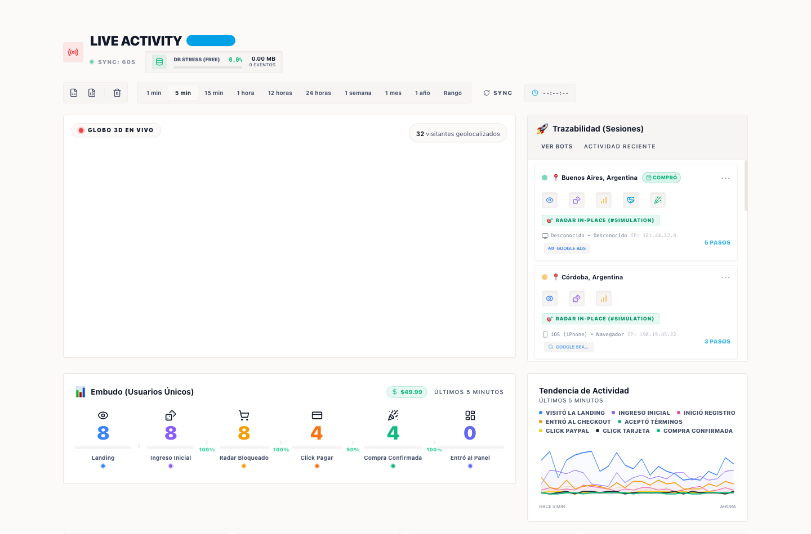

# ⚡ LiveFunnel

> **Analítica de conversión en tiempo real con globo 3D interactivo, embudo de ventas y trazabilidad forense de sesiones.**  
> Diseñado para **Next.js 14 (App Router)** y **Supabase (PostgreSQL)** con impacto cero en la cuota gratuita (*Free Tier*).



---

## 🎯 ¿Por qué LiveFunnel?

| Característica | Google Analytics 4 | Mixpanel / Amplitude | **LiveFunnel** |
| :--- | :--- | :--- | :--- |
| **Tiempo de respuesta** | Minutos / Horas de retraso | Segundos | **Tiempo real instantáneo (WebSockets/Polling)** |
| **Visualización** | Tablas y gráficos genéricos | Embudos estáticos | **Globo 3D interactivo sin costo de APIs** |
| **Trazabilidad por sesión** | Muestreo anonimizado | Por eventos aislados | **Línea de tiempo paso a paso por usuario** |
| **Modelo Comercial** | Basado en vistas de página | Planes por volumen | **Soporta Pago Único y Suscripciones** |
| **Infraestructura** | Nube cerrada de Google | Servicios privativos | **100% Auto-hospedado en tu Supabase y Vercel** |

---

## ✨ Características Principales

- 🌍 **Globo 3D Autónomo en Canvas:** Renderizado ortográfico 3D nativo y ligero. Funciona sin costo de tokens ni APIs externas (con soporte opcional para Mapbox GL).
- 📊 **Embudo de Conversión CRO:** Mide visitantes únicos, tasas de conversión paso a paso, ingresos acumulados y abandonos en tiempo real.
- 🕵️ **Trazabilidad Forense por Sesión:** Registro cronológico de acciones por usuario para auditar el comportamiento antes de pagar o abandonar.
- 💳 **Modelos Híbridos de Pago:** Diseñado tanto para **Pago Único** (packs de créditos, servicios, productos digitales) como para **Suscripciones Recurrentes** (SaaS).
- 🛡️ **Protección de Cuota Free Tier:** Pushdown SQL con agregación dentro de PostgreSQL; evita transferir miles de filas sueltas a la memoria de la aplicación.
- 🎨 **Diseño Claro Institucional:** Interfaz moderna y minimalista con paleta corporativa y cero estética genérica de IA.

---

## 🚀 Inicio Rápido en 3 Pasos

### 1. Clonar e instalar dependencias
```bash
git clone https://github.com/mylnzon58/livefunnel.git
cd livefunnel
npm install
```

### 2. Configurar la base de datos (Supabase)
Copiá el contenido de [`supabase/schema.sql`](supabase/schema.sql) y pegalo en el **SQL Editor** de tu proyecto de Supabase.

> Crea la tabla `funnel_events`, índices optimizados y la función RPC `get_live_dashboard_stats` para cálculos inmediatos.

### 3. Variables de entorno y ejecución
Copiá el archivo de configuración:
```bash
cp .env.example .env.local
```

Completá tus credenciales en `.env.local`:
```env
NEXT_PUBLIC_SUPABASE_URL=https://tu-proyecto.supabase.co
SUPABASE_SERVICE_ROLE_KEY=tu_clave_secreta_service_role

# Opcional (si tenés token de Mapbox; si no, se activa el globo 3D autónomo)
NEXT_PUBLIC_MAPBOX_TOKEN=
NEXT_PUBLIC_MAPBOX_STYLE=mapbox://styles/mapbox/light-v11
```

Iniciá el entorno de desarrollo:
```bash
npm run dev
```
Abrí [http://localhost:3000](http://localhost:3000). Si aún no configuraste la base de datos, el panel iniciará automáticamente en **modo demostración** para que puedas explorarlo al instante.

---

## 🔌 Cómo Integrar el Tracking en Tu Proyecto

### 1. Desde el Navegador (Botones CTA y Formularios)
Usá el helper `track` que utiliza `navigator.sendBeacon` para garantizar que los eventos se envíen incluso si el usuario es redirigido a una pasarela de pago:

```tsx
import { track } from "@/lib/track";

// Ejemplo: Pago Único (paquete de créditos, producto, servicio)
export function BuyOnceButton() {
  return (
    <button
      onClick={() => {
        track("click_payment", {
          model: "onetime",
          product: "pack_creditos",
          amount: 19.99,
          gateway: "mercadopago" // o "stripe" / "square"
        });
      }}
    >
      Pagar y Obtener Acceso
    </button>
  );
}

// Ejemplo: Suscripción Recurrente
export function SubscribeButton() {
  return (
    <button
      onClick={() => {
        track("click_payment", {
          model: "subscription",
          plan: "mensual",
          amount: 29.99,
          gateway: "stripe"
        });
      }}
    >
      Suscribirme Ahora
    </button>
  );
}
```

### 2. Tracking Automático de Páginas
Colocá el componente invisible en cualquier página o layout:

```tsx
import { LiveEventBeacon } from "@/components/LiveEventBeacon";

export default function PricingPage() {
  return (
    <div>
      <LiveEventBeacon type="page_view" metadata={{ section: "pricing" }} />
      <h1>Precios y Planes</h1>
    </div>
  );
}
```

### 3. Desde el Servidor (Webhooks de Pago)
Para registrar ventas confirmadas desde tus webhooks de MercadoPago, Stripe, PayPal o Square:

```typescript
import { trackServer } from "@/lib/server";

export async function POST(req: Request) {
  // Webhook verificado de la pasarela

  await trackServer("purchase", {
    amount: 19.99,
    currency: "USD",
    model: "onetime", // o "subscription"
    user_id: "user_123" // Une la compra con la sesión del usuario
  });

  return new Response("OK", { status: 200 });
}
```

---

## 📦 Consumir como Librería en Otra Aplicación

Podés importar directamente componentes y utilidades desde `src/index.ts`:

```tsx
import { 
  LiveActivityClient, 
  LiveWorldMap, 
  LiveFunnelBar, 
  track 
} from "@/index";
```

---

## 📜 Licencia y Reconocimiento

Distribuido bajo la **Licencia Apache 2.0**.  
Podés usarlo libremente en proyectos comerciales, personales o de código abierto.

**Reconocimiento de la idea:**  
Conforme a la cláusula 4(d) de la Licencia Apache 2.0 y el archivo [`NOTICE`](NOTICE), cualquier derivación o uso del proyecto debe preservar el crédito al autor original:

> **Idea original y arquitectura creada por: [`mylnzon58`](https://github.com/mylnzon58)**
